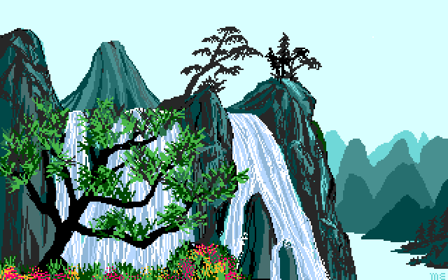

# VGA Showcase

[](https://github.com/bstar/vga-showcase/actions/workflows/dos.yml)
[](https://github.com/bstar/vga-showcase/releases/latest)

A real-mode DOS slideshow of 32 archived GIF pictures, using VGA and banked
SVGA in 256-color modes. Original images and their source credits are included.



## Download and run

Download [VGADEMO.ZIP](https://github.com/bstar/vga-showcase/releases/latest/download/VGADEMO.ZIP),
extract it into `C:\VGADEMO`, then:

```dos
C:
CD \VGADEMO
DEMO
```

`DEMO` uses VESA for SVGA. Use `CIRRUS` for native Cirrus Logic GD54xx modes, or
`TSENG` for a Tseng ET4000. Select the backend that matches your card.
No installer, TSR or boot changes.

Pictures advance after ten seconds and loop. Space pauses/resumes;
Right or Enter advances; Left goes back; Esc exits to text mode.
`SHOWCASE /START 17` starts at picture 17; `/ONCE` stops after the last picture.
These options also work with `/CIRRUS` or `/TSENG`.

## Requirements

DOS 3.0+, VGA/SVGA and a compatible monitor. A 386 is a practical target.
The collection uses 320x200, 640x480 and 800x600 modes; 800x600x256 needs at
least 512 KiB video RAM. No FPU, EMS or XMS is required.

Images retain their pixels and colors at the VGA DAC's 6-bit channel precision.
Smaller images are centered. The player loads predecoded `PICS` data for speed;
the unchanged original files are in `GIFS`.

## Build

```sh
nix develop --command python3 tests/run.py
```

Or use Open Watcom 2, Python 3 and ImageMagick:
`./build.sh --watcom /path/to/watcom`, then `python3 tools/package.py`.
The executable and data are in `build/VGADEMO`; the release ZIP and checksums
are in `dist`. CI uses a checksum-verified upstream compiler SDK.

Tests read back every pixel and palette entry for all 32 slides under VESA and
native ET4000 emulation, then exercise the packaged player. Native Cirrus modes
were previously checked against QEMU/FreeDOS. These are emulator results,
not a claim of physical-card acceptance. See [technical notes](docs/format.md).

## Credits and license

Code and tools are [MIT licensed](LICENSE), copyright 2026 bstar.
The archived artwork retains its original credits. See [CREDITS.md](CREDITS.md)
and the [image source list](images/sources.json).
